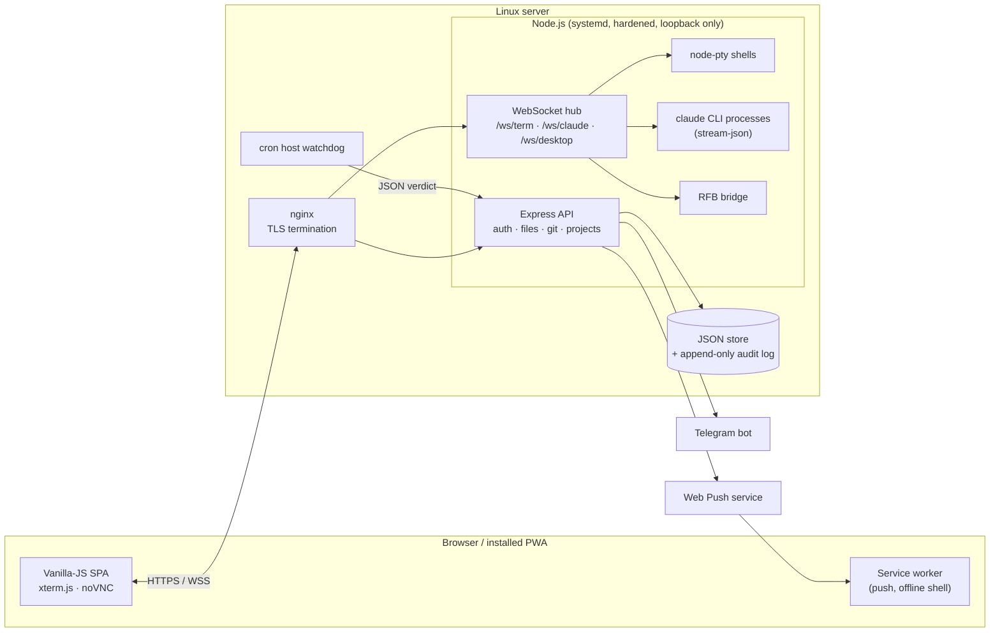

# DevSpace

**A secure, self-hosted, phone-first developer portal for driving Claude Code on a remote server — from any browser.**

DevSpace replaces "SSH + VS Code Remote" with a purpose-built web app: a real
terminal, a full chat UI over the `claude` CLI, a file manager, Git, and a
remote desktop — all behind **passkey-only** authentication and designed to be
used one-handed on a 360 px phone screen.

> This repository is a public overview of the project: what it does, how it is
> built, and the engineering decisions behind it. The source code itself is
> private because it runs production infrastructure.

---

## Why it exists

Working on a server from a phone is miserable: SSH keys are awkward to carry,
VS Code's web UI is unusable on a small screen, and every dropped mobile
connection kills whatever was running. DevSpace fixes all three:

- **Nothing to carry or type** — log in with Face ID / fingerprint / Windows Hello.
- **Sessions survive a locked phone** — terminals and AI chats are server-side
  processes, decoupled from the browser socket, replayed on reconnect.
- **Phone first** — icon-only navigation, a Termux-style key bar, swipe
  gestures, safe-area insets, and a hard rule that nothing scrolls sideways at 360 px.
- **Per-project context** — each project opens in its own directory, so Claude
  Code automatically loads that project's own instructions and memory.

## Features

### AI chat over the Claude Code CLI
- Runs the real `claude` CLI in streaming-JSON mode and renders the event stream
  as a chat UI — multiple concurrent chats as tabs, each bound to a project.
- Per-chat model and permission mode, switchable mid-conversation without losing context.
- In-browser **Allow / Deny** for tool permissions — also answerable straight
  from a lock-screen push notification.
- Rich tool rendering: collapsible tool calls, diff cards for file edits,
  images returned by tools, a live **subagent panel**, collapsed "thinking" rows.
- Context-window meter, usage/rate-limit indicators, slash-command palette,
  `@`-file picker, image paste, voice input, pinned quick prompts, Markdown export.
- **Scheduled runs** and a review queue for unattended jobs, plus a token ledger.

### Terminal
- `node-pty` ↔ WebSocket ↔ `xterm.js`, several shells per project.
- 256 KB ring buffer replayed on reattach — a dropped connection loses nothing.
- Mobile key bar (Esc, Tab, arrows, Ctrl-combos, `|`, `~`) because phone keyboards have none of those.

### Files & Git
- Sandboxed browse / edit / create / rename / delete, upload, download, and
  **streamed folder-to-ZIP** (hand-written ZIP writer on top of `zlib`).
- Image & PDF preview with real pinch-zoom; project-wide search that jumps to file + line.
- Git status, coloured per-file diffs, selective commit, and confirmed push.

### Remote desktop
- A full XFCE desktop on a headless server, bridged over a WebSocket to noVNC
  by the portal itself — usable on a phone.

### Operations & safety net
- **Web Push** notifications when a task finishes or needs permission.
- **Telegram watchdog** on every login, failed auth, device enrolment, deploy and push.
- Host health dashboard fed by an independent cron watchdog (keeps working when the portal is down).
- One-button deploy, a staging instance, and a deploy verifier that proves the running commit matches HEAD.
- Installable **PWA** with per-install name and icon colourway, so several
  servers' portals can sit side by side on one phone.
- Portable installer: a fresh box gets a setup wizard; an existing box is upgraded without questions; `--dry-run` rehearses everything without root.

## Architecture

More detail: [docs/architecture.md](docs/architecture.md).

## Security model (summary)

Security is the point of this tool — it is a shell on a production server,
reachable from the internet.

| Threat | Mitigation |
|---|---|
| Someone finds the URL | Every route except the login ceremony returns 401. No username or password field exists to attack. |
| Phishing / replay | WebAuthn passkeys are origin-bound; a look-alike domain cannot produce a valid assertion. |
| Stolen phone | User verification (biometric/PIN) is **required**, not preferred. |
| Cloned authenticator | Signature-counter regression is treated as a clone alarm. |
| CSRF | Every mutating request needs a per-session token header. |
| Path traversal / symlink escape | One resolver for every client path; both sides are `realpath`-ed, so a symlink out of a project is refused. |
| Stored XSS via project files | Only whitelisted types are served inline, under a `sandbox` CSP with `nosniff`; everything else is an attachment. |
| Command injection | Every subprocess is `execFile` with an argv array — never a shell string. |
| Portal compromise → root | systemd `NoNewPrivileges`, `PrivateTmp`, `ProtectSystem`; privileged actions go through a root-owned wrapper with a closed verb list. |
| Silent compromise | Real-time Telegram alerts plus an append-only audit log. |

**No password fallback, no recovery email, no admin backdoor** — any of those
would become the real security of the system. Full write-up: [docs/security.md](docs/security.md).

## Tech stack

| Layer | Choice |
|---|---|
| Backend | Node.js 22, Express 4, `ws`, `node-pty` |
| Auth | WebAuthn via `@simplewebauthn/server`, HMAC-signed sessions |
| Frontend | Vanilla ES modules — **no framework, no bundler, no build step** |
| Terminal / desktop | xterm.js, noVNC, TigerVNC + XFCE |
| Notifications | Web Push (VAPID), Telegram Bot API |
| Storage | JSON document store + JSON-lines audit log (no database) |
| Infra | nginx + Let's Encrypt, systemd (hardened), cron watchdog, Bash installer |
| Testing | Custom Node/Python QA harnesses with ~1,500 assertions |

Eight production dependencies, each load-bearing. The no-build frontend is
deliberate: the portal is the tool you use to fix the server, so fixing it must
never require a working toolchain.

## By the numbers

- ~25,000 lines of JavaScript, shell, HTML and CSS
- 110+ commits across 25 feature releases (Aug – Oct 2026)
- 8 production dependencies
- ~1,500 automated QA assertions across 80+ check scripts
- 8 operator docs (overview, architecture, security, API, frontend, operations, development, audit)

## Engineering highlights

Some of the more interesting problems — see [docs/engineering-notes.md](docs/engineering-notes.md):

- Keeping AI sessions alive across a phone locking, unlocking and changing networks.
- Making a WebAuthn relying-party migration free of re-enrolment by moving it to the apex domain.
- Proving (rather than assuming) that systemd hardening was actually live — it wasn't, for seven weeks.
- A host watchdog that went blind the instant `PrivateTmp` was turned on.
- Lock-screen permission approvals from a service worker that cannot read the CSRF token.

## Author

Built and operated by **Sarvesh** — design, backend, frontend, security and
infrastructure. Developed in close collaboration with Claude Code as a
pair-programmer, which is also what the portal itself is built to drive.
